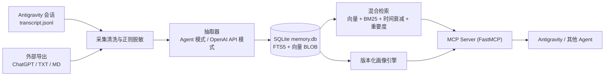

# Personal Assistant

**本地优先、可自我迭代的个人记忆与用户画像助理（MCP 服务 + Antigravity 插件）**

> A local-first, self-evolving personal memory & user-profile assistant built on SQLite (FTS5 + local embeddings) and Model Context Protocol (MCP).

---

## 核心特性

- **四层记忆体系**：
  - **L0 核心精简画像**（≤600 字）：由 `SessionStart` Hook 轻量注入新窗口，低 token 开销。
  - **L1 语义记忆**：关于用户的长期事实、偏好、技能证据、目标与习惯，按需检索召回。
  - **L2 情景记忆（Episodes）**：跨会话的事件与结论摘要。
  - **L3 原始归档**：原始对话与文本来源只做溯源，不常驻上下文。
- **混合检索引擎**：本地 `jieba` 中文分词 + SQLite FTS5（BM25）+ 本地向量（`BAAI/bge-small-zh-v1.5`，512 维，懒加载）+ 重要度 + 时间衰减（90 天半衰期）；无向量模型时自动退化为纯 BM25 检索。
- **双抽取线路**：
  - `agent` 模式（默认）：无需额外 API Key，由当前对话模型通过 `ingest_next` / `ingest_commit` 完成抽取。
  - `api` 模式（可选）：在 `config.toml` 配置 OpenAI 兼容 `/chat/completions` 接口（`base_url`、`model`、`PA_API_KEY`），后端自动批量抽取与反思。
- **版本化用户画像与自我迭代**：支持 `propose`（生成 diff）→ 用户确认 → `apply`（版本化保存）→ `rollback`（随时回滚），以及即时纠正 `profile_correct`。
- **隐私安全**：全程本地存储；入库前内置正则脱敏（API Key、Token、密码、身份证号、手机号）；`private` 级别记忆默认隔离。

---

## 架构概览



---

## 安装与初始化

一般用户建议先创建虚拟环境再安装；若本机为 Microsoft Store 版 Python（受 App Execution Alias 限制无法创建 `.venv`），可直接全局安装：

```bash
git clone https://github.com/Nanoda16/personal-assistant.git
cd personal-assistant

# 推荐（标准 Python 环境）：
python -m venv .venv
# Windows: .venv\Scripts\activate  |  macOS/Linux: source .venv/bin/activate

# 安装（含本地向量模型依赖）
pip install -e ".[local-embed]"
# 若仅使用纯关键词检索（不装 PyTorch / sentence-transformers）：
# pip install -e .
```

初始化数据目录（默认 `~/.personal-assistant`，可通过环境变量 `PA_HOME` 覆盖）：

```bash
python -m personal_assistant init
python -m personal_assistant doctor
```

---

## 接入 Antigravity 插件

运行一键安装命令，将插件模板与本机绝对路径渲染到 `~/.gemini/config/plugins/personal-assistant/`：

```bash
python -m personal_assistant install-antigravity
# 可选指定独立数据目录：
# python -m personal_assistant install-antigravity --pa-home D:\path\to\data
```

安装后在 Antigravity 插件管理页面确认启用 `Personal Assistant` 即可：
- 新会话开启时会自动注入 ≤600 字的精简画像；
- 调用 `assistant` skill 开启完整助理模式（加载完整画像并按需检索记忆）；
- 调用 `memory-ingest` skill 导入历史会话或外部数据；
- 调用 `reflect` skill 总结近期记忆并提出画像更新提案。

---

## 接入其他 Agent（Claude Code、Cursor 等）

本项目的存储、检索、画像与导入内核与具体宿主完全解耦，任何支持 **MCP (stdio)** 的客户端都可以直接使用。

### 1. 配置 MCP Server

在 Claude Code 或 Cursor 的 MCP 配置文件中添加：

```json
{
  "mcpServers": {
    "personal-assistant": {
      "command": "/path/to/python",
      "args": ["-m", "personal_assistant.server"],
      "env": {
        "PA_HOME": "/path/to/personal-assistant-data"
      }
    }
  }
}
```

### 2. 复用 Skill 指令

将 `integrations/antigravity/plugin/skills/assistant/SKILL.md` 与 `rules/AGENTS.md` 中的工作流与隐私规范放入对应 Agent 的系统提示词或项目规则（如 `.cursorrules` / `CLAUDE.md`），即可获得完整助理体验。

---

## 开启 API 自动抽取模式（可选）

编辑 `$PA_HOME/config.toml`（可从 `config.example.toml` 复制）：

```toml
[extractor]
mode = "api"

[api]
base_url = "https://api.openai.com/v1"
model = "gpt-4o-mini"
api_key_env = "PA_API_KEY"
```

在运行环境中设置 `PA_API_KEY`，即可使用 `ingest_run` 或 `reflect_run` 自动执行抽取与反思。

---

## 隐私说明

- 所有数据库（`memory.db`）、队列（`queue.jsonl`）与缓存文件均保存在本地 `$PA_HOME`，不会上传至任何第三方服务器（除非你主动开启 `api` 模式）。
- 入库前自动对常见密钥、Token、手机号、身份证号进行正则脱敏。
- 可随时通过 `python -m personal_assistant forget <关键词> --apply` 删除记忆，或通过 `export` 导出全部数据。

## License

MIT
